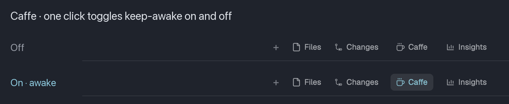

# Caffe

A toggle button for the [Herdr](https://herdr.dev) tab bar that keeps your
computer awake. Click it once to stop display sleep and idle sleep. Click it
again to let the computer sleep as usual.



| Platform | What the button runs |
|---|---|
| macOS | `caffeinate -d -i` |
| Linux (GNOME) | `gnome-session-inhibit --inhibit idle:suspend` |
| Linux (other) | `systemd-inhibit --what=idle:sleep --mode=block` |

The lock ends by itself when Herdr quits. The button stops only the lock it
started, never a `caffeinate` you run yourself.

## Install

Ask your agent:

> Read ~/.config/herdr-app/AGENTS.md, then add this mod: https://github.com/jrobertojunior/herdr-caffe

Or copy `mods/caffe/` to `~/.config/herdr-app/mods/caffe/` and add this block
to the tab bar row of your own layout (clone a shipped layout first):

```json
{ "id": "caffe-toolbar-button", "type": "block", "size": { "px": 76 }, "content": { "mod": "caffe" } }
```

Then run `herdr-app check ~/.config/herdr-app/mods/caffe`.

`RECIPE.md` describes the mod in full, so an agent can build it again from
scratch.

## License

MIT
