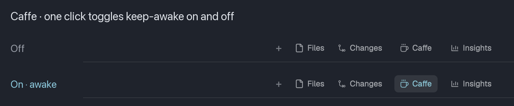

# Caffe

A small "Caffe" toggle button with a coffee cup in the tab bar. Click it and
the computer stays awake: no display sleep, no idle sleep. Click it again and
the computer sleeps as usual. On macOS it runs `caffeinate -d -i`; on Linux
it takes a systemd-inhibit lock (or a GNOME session lock on GNOME). The lock
ends by itself when Herdr quits.



## What you see

- One button, 26px high, inside a 76px block in the tab bar, between the
  panel buttons (Files, Changes) and Insights in the preview.
- The block has the tab bar's look: `chrome` background, a 1px `border`
  line at the bottom, 4px padding on the right, the button centered
  vertically.
- The button: 8px side padding, 5px gap, radius 6, 12px text "Caffe" with a
  14px coffee-cup icon (`coffee.svg`, a 24×24 stroke icon tinted with the
  text color).
- Off: `chrome` background, `muted` text and icon.
- On: `selected` background, `accent` text and icon.

## How it behaves

- Click: starts the lock when it is off, stops it when it is on. Before it
  acts, it asks the system whether the lock still runs, so a lock that ended
  by itself never needs two clicks.
- Hover: `hover` background; off it turns `foreground`, on it stays `accent`.
  The tooltip says "Keep this computer awake" (off) or "This computer stays
  awake. Click to stop." (on).
- A press on the button does not drag the window (the tab bar is a
  `window_drag` row).
- Every copy of the button (other layouts, other windows) shows the same
  state, and after a restart of Herdr the button shows the true state.
- When the lock cannot start (no tool, an unsupported system, the lock is
  refused), an error toast titled "Caffe" says why and the button stays off.
- When Herdr quits, the lock ends: at once on macOS, within 5 seconds on
  Linux.
- Agent statuses do not change the button.

## Built from

- `mods/caffe/` (`mod.json`: `{ "place": "none", "title": "Caffe" }`), so it
  appears only where a layout puts it. Add it to your layout's tab bar row
  as a block next to the existing ones:

  ```json
  { "id": "caffe-toolbar-button", "type": "block", "size": { "px": 76 }, "content": { "mod": "caffe" } }
  ```

  The shipped layouts are read-only: clone one first
  (`herdr-app do layout.clone '{"name":"main","as":"my-layout"}'`), then
  turn its `tabs` block into a row with the `tabs` mod (weight 1) and this
  block.
- `main.js`: a `View` that calls `exec("sh", [<appHome>/mods/caffe/caffe.sh,
  action, <appHome>/data/caffe/pid])`. It keeps the state in
  `shared("caffe.on")` so every copy redraws together, and reads it once in
  `init` with `check`. Errors go to `notify({ level: "error" })`.
- `caffe.sh start|stop|check <pidfile>`, plain POSIX `sh`:
  - `check`: exits 0 when the pid in the file is alive and its name is
    `caffeinate`, `*inhibit*` or `gnome-session*`.
  - `start`: does nothing when `check` passes. Else it starts the lock in
    the background, writes `$!` to the pid file, waits 0.5 s and fails when
    the lock already died.
    - macOS: `caffeinate -d -i -w $PPID`.
    - Linux on GNOME (`XDG_CURRENT_DESKTOP` has `GNOME`) with
      `gnome-session-inhibit`: `gnome-session-inhibit --app-id herdr
      --reason "Herdr Caffe" --inhibit idle:suspend sh -c "<wait loop>"`.
    - Other Linux: `systemd-inhibit --what=idle:sleep --who="Herdr Caffe"
      --why="Keep this computer awake" --mode=block sh -c "<wait loop>"`.
    - The wait loop: `while kill -0 $PPID; do sleep 5; done`.
  - `stop`: when `check` passes, `pkill -P <pid>` (the wait loop) and
    `kill <pid>`; then it deletes the pid file.
- Programs it runs: `sh`, `ps`, `grep`, `kill`, `pkill`, `sleep`, `uname`,
  and `caffeinate`, `systemd-inhibit` or `gnome-session-inhibit`.
- Files: it writes only `data/caffe/pid` under the app home. No network.

## Watch out

- `$PPID` in the script is Herdr itself: Herdr starts the `sh` of `exec`
  directly. That is how the lock follows Herdr's life. Don't run the script
  through another shell or `hc`, or the lock follows that process instead.
- Never find the lock with `pgrep caffeinate`: the person may run their own
  `caffeinate` in a terminal, and the button must not stop it. Use only the
  pid file.
- Don't stop the lock in `close()`: Herdr also calls it on a layout switch,
  and the person expects the computer to stay awake.
- On Linux, `kill` of systemd-inhibit alone leaves its child loop running;
  `pkill -P` stops it.
- GNOME blanks the screen on its own idle timer and does not follow logind's
  idle lock, so the script uses `gnome-session-inhibit` there. Other
  desktops differ: logind's `sleep` lock always stops suspend, but whether
  the screen still blanks depends on the desktop's idle daemon.
- Windows: not supported; the button shows an error toast.
- `herdr-app check` does not wait for `exec` in `init`, so it passes before
  the first state read.

## Done when

- `herdr-app check ~/.config/herdr-app/mods/caffe` passes.
- The button shows in the tab bar, off, with a muted coffee cup.
- macOS: after a click, `pmset -g assertions` lists `caffeinate` with
  `PreventUserIdleDisplaySleep` and `PreventUserIdleSystemSleep`, on behalf
  of Herdr's pid, and the button is accent-colored.
- Linux: after a click, `systemd-inhibit --list` shows "Herdr Caffe" with
  `sleep:idle` and `block` (or GNOME's session lock on GNOME).
- A second click removes the lock and the button is muted again.
- A `caffeinate` started in a terminal keeps running after both clicks.
- After quitting Herdr with the lock on, no Caffe lock remains (Linux: after
  5 seconds), and `data/caffe/pid` points to no live lock.
